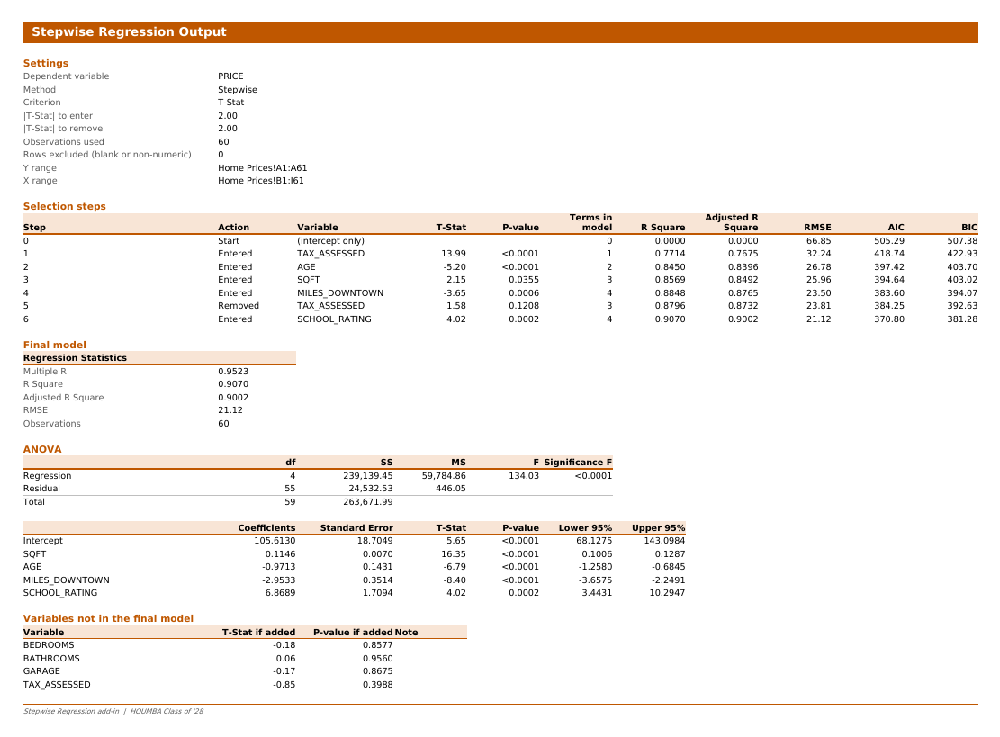

# HOUMBA-28 Stepwise Regression

An Excel add-in that runs **forward selection**, **backward elimination** and **stepwise regression**, then writes a report in the same layout as Excel's Data Analysis > Regression tool (with Standard Error shown as RMSE). Variables enter and leave on **|T-Stat| ≥ 2** by default, or on p-values if you prefer.

- Works in Excel for the web, Windows and Mac.
- No macros, no Trust Center settings, nothing to install on your computer.
- Your data never leaves your workbook.

**Install page:** https://cranksrust.github.io/stepwise-regression-excel/

## Install (students)

The add-in is not in the Office Add-ins store yet, so it is installed from a small file called `manifest.xml`. This takes about two minutes and only needs to be done once per browser or computer.

### Step 1: Download the manifest

1. Go to https://cranksrust.github.io/stepwise-regression-excel/
2. Click **Download manifest.xml** and save it somewhere easy to find, such as Downloads.

### Step 2: Add it to Excel

**Excel for the web (recommended, works for everyone)**

1. Go to [office.com](https://www.office.com/launch/excel) and open any workbook.
2. Open **Add-ins**. Where it is depends on your window width:
   - Wide window: **Home** tab, **Add-ins** button at the right end of the ribbon.
   - Narrow window: click the **⋯** at the right end of the Home ribbon, or use the **Insert** tab, **Add-ins**.
3. Click **More Add-ins** (on some versions, **Advanced**).
4. Open the **My Add-ins** tab and click **Upload My Add-in** near the top right.
5. Click **Browse**, choose `manifest.xml`, and click **Upload**.
6. A **Stepwise Regression** button appears on the Home tab (in a narrow window, it may be under the **⋯**).

**Excel for Mac**

1. Quit Excel.
2. In Finder, press **Cmd+Shift+G**, paste `~/Library/Containers/com.microsoft.Excel/Data/Documents/wef` and press Return. If it says the folder does not exist, go to `~/Library/Containers/com.microsoft.Excel/Data/Documents` and create a folder named `wef`.
3. Copy `manifest.xml` into the `wef` folder.
4. Open Excel and a workbook, then go to **Home > Add-ins** (or **Insert > Add-ins > My Add-ins**). **Stepwise Regression** is listed under the developer or shared add-ins section. Click it once and the button appears on the Home tab.

**Excel for Windows (desktop)**

Go to **Home > Add-ins > More Add-ins > My Add-ins**. If **Upload My Add-in** is shown, follow steps 4 to 6 above. If it is not, use Excel for the web.

### Step 3: Run a regression

1. Click **Stepwise Regression** on the Home tab. A panel opens on the right.
2. Select your Y column, including its label cell, and click **Use selection** next to **Y range**.
3. Select your X columns, including their label cells, and click **Use selection** next to **X range**. Hold Ctrl (Cmd on Mac) to pick columns that are not next to each other.
4. Leave **First row contains labels** ticked if you included the labels.
5. Choose the **Method** (Stepwise is the default) and **Criterion** (T-Stat, entering and removing at |T-Stat| = 2.00, is the default).
6. Click **Run regression**. The report opens on a new sheet named **Stepwise**.

### Try it with sample data

Download [home-prices.xlsx](https://cranksrust.github.io/stepwise-regression-excel/sample/home-prices.xlsx): 60 fictional home sales with eight candidate predictors. Use Y `A1:A61` and X `B1:I61` on the **Home Prices** sheet, then run Forward, Backward and Stepwise and compare the steps.

| Step | Forward | Backward | Stepwise |
|---|---|---|---|
| Start | intercept only | all 8 | intercept only |
| 1 | + TAX_ASSESSED | − GARAGE | + TAX_ASSESSED |
| 2 | + AGE | − BATHROOMS | + AGE |
| 3 | + SQFT | − BEDROOMS | + SQFT |
| 4 | + MILES_DOWNTOWN | − TAX_ASSESSED | + MILES_DOWNTOWN |
| 5 | + SCHOOL_RATING | | − TAX_ASSESSED |
| 6 | | | + SCHOOL_RATING |
| Final R Square | 0.9082 (5 terms) | 0.9070 (4 terms) | 0.9070 (4 terms) |

TAX_ASSESSED looks like the best single predictor, but it only echoes the real drivers. Stepwise drops it once they are in the model (its T-Stat falls to 1.58). Forward selection never re-checks, so it ends with TAX_ASSESSED still in the model at a T-Stat of −0.85.

### If something goes wrong

| Problem | Fix |
|---|---|
| No **Add-ins** button | The window is too narrow. Check under **⋯** on the Home ribbon or the **Insert** tab, or widen the window. |
| **Upload My Add-in** is missing or greyed out | Your school or work account may block custom add-ins. Sign in to office.com with a personal Microsoft account and try again. |
| The button disappeared | In Excel for the web, uploaded add-ins are remembered per browser. Upload the manifest again. |
| "Every X column must start and end on the same rows as Y" | Select the same rows for Y and X, for example `A4:A48` and `B4:F48`. |
| "The model with every predictor cannot be estimated" | Two X columns carry the same information (for example one is a fixed number minus the other). Remove one, or use Forward or Stepwise. |

More help: https://cranksrust.github.io/stepwise-regression-excel/support.html

## About

Built by the University of Texas at Austin's MBA at Houston Class of '28 for Professor Tom Sager's BA 286T Statistics course, Fall 2026.

- [MAINTAINING.md](MAINTAINING.md): how the add-in works, hosting, tests and publishing to the Office Add-ins store.
- [vba/](vba/): the original VBA (.xlam) version for desktop Excel, kept as a backup.
- Released under the [MIT License](LICENSE).
